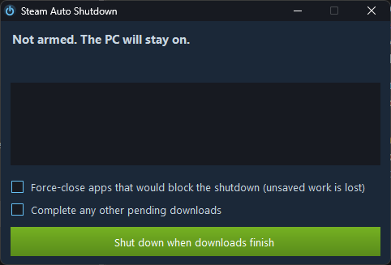

# Steam Auto Shutdown

> [!WARNING]
> **This app was written by AI (Claude) for my own personal use.**
> It has not been professionally reviewed or audited. You're free to use, copy and modify it,
> but **entirely at your own risk**. It comes with no warranty and no support, and I accept no
> responsibility for any data loss, security issues or other problems that result from using it.
> Released under the [MIT License](LICENSE).

A small Windows app that shuts your PC down when Steam finishes downloading.



## Download

Get `SteamAutoShutdown.exe` from the [latest release](../../releases/latest) and run it. There's nothing to install, and it needs no admin rights. It uses the .NET Framework 4 that comes with Windows 10 and 11.

The program isn't code-signed, so Windows SmartScreen may warn you the first time. You can [build it yourself](#building) instead.

## Usage

1. Start your downloads in Steam.
2. Open the app and click **Shut down when downloads finish**.
3. Leave the window open. Closing it cancels everything.

When the downloads finish, the app waits 30 seconds in case Steam starts another one. It then shows a Windows notification and counts down for 30 seconds. Click **Cancel - keep the PC on** at any point to stop it.

While it's watching, the app also keeps the PC from going to sleep.

### Options

- **Force-close apps that would block the shutdown:** off by default, because unsaved work in those apps is lost. If it's off, an app with unsaved work can stop the shutdown.
- **Complete any other pending downloads:** resumes paused and scheduled updates, so they finish before the shutdown. See [the note below](#complete-any-other-pending-downloads) before using it.

### When it won't shut down

The app only shuts down after a download has actually completed and nothing else is waiting. It stays on if:

- A download it's watching is paused or suspended, or has stopped with an error such as a full disk.
- A game is running, or Steam is closed.
- A download was removed from the queue or rescheduled, and nothing else completed.

This means the PC can stay on if a download never resumes. Updates that were already paused before you started the app are ignored, unless you use the option below.

## How it works

The app follows Steam's download log (`logs\content_log.txt`) to see each game's state, and checks Steam's "updating" flags in the registry as a second signal. Its own activity is logged to `%LOCALAPPDATA%\SteamAutoShutdown\activity.log`.

### Complete any other pending downloads

Steam has no official way for another program to resume downloads, so this option uses undocumented Steam internals:

- If Steam isn't already in debug mode, the app restarts it once with `-cef-enable-debugging`. It won't do this while a game is running.
- It then makes the same calls as the buttons on Steam's Downloads page.
- While Steam is in debug mode, other programs on your PC can control Steam through a local port (8080). This lasts until Steam next restarts, and nothing is changed on disk. If you cancel instead of shutting down, restart Steam to close the port.
- A Steam update could break this. If it fails, the app shows why and keeps watching your other downloads.

Resuming paused updates has been tested for real. Scheduled updates use the same call but haven't been tested.

## Building

You only need Windows, as the C# compiler comes with the .NET Framework. Run:

```bat
build.bat
```

This runs the tests in `src\Tests.cs`, then builds `SteamAutoShutdown.exe`. `tools\make-icon.ps1` regenerates the icon.

To try it safely, use these options:

| Option | What it does |
| --- | --- |
| `--dry-run` | Logs the shutdown instead of doing it, and doesn't change Steam |
| `--real-resume` | With `--dry-run`, really resumes pending downloads but still never shuts down |
| `--log <path>` | Reads a different log file, so you can simulate downloads |
| `--auto-arm` | Starts watching straight away |
| `--complete-pending` | Ticks the pending downloads option |
| `--grace <seconds>` | Changes the 30-second wait for more downloads |
| `--countdown <seconds>` | Changes the 30-second shutdown countdown |

## Disclaimer

This is an unofficial project, not affiliated with or endorsed by Valve. Steam is a trademark of Valve Corporation.

## License

[MIT](LICENSE)
